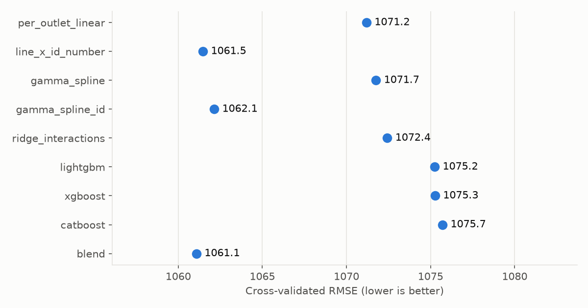
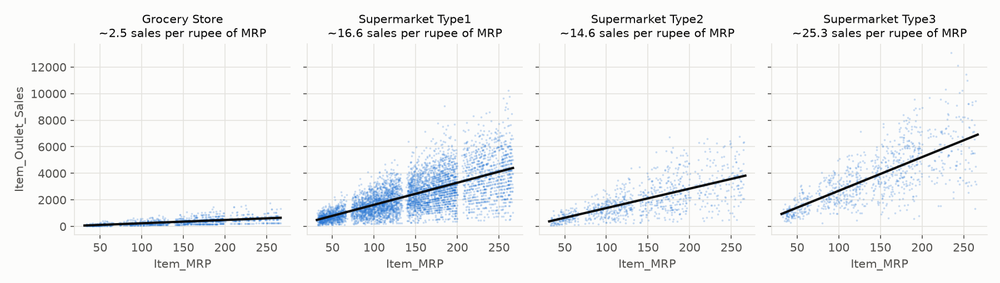
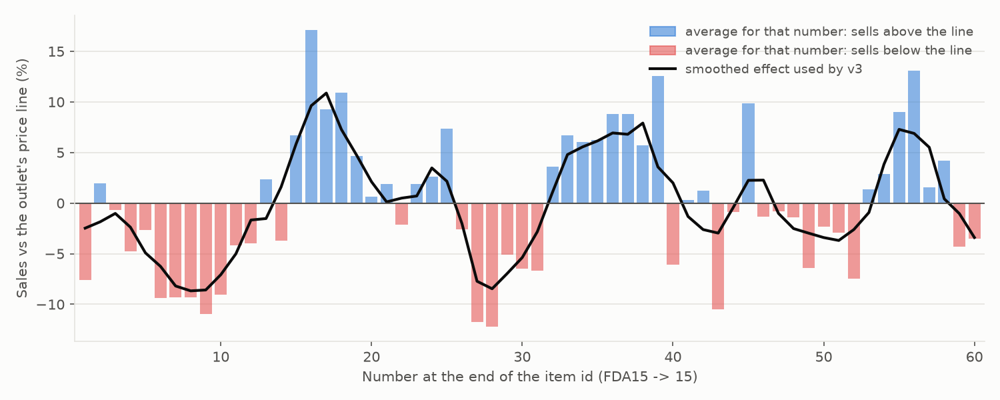

# StatsMart: BigMart Sales Prediction

Predicting `Item_Outlet_Sales` for 5,681 (item, outlet) pairs across 10 BigMart stores, scored by RMSE.
The project went from public RMSE **1147.91 (rank #523)** to **1136.88 (rank #41)** in four submissions.
The jump came from finding a hidden signal in the item id, not from bigger models.
v4 lowers cross-validated RMSE again, from 1061.1 to **1059.9**. It treats that id signal as a repeating wave
and models units sold as counts. Its public score, 1136.93 (#41), ties v3's 1136.88 within the public slice's noise.
v5 reaches CV **1059.4** and the best public score, **1136.80**, by handling an explicit rule in the data. Every sale
is exactly whole units × the item's true price, and the `Item_MRP` column is that price plus deliberate noise of up to ±2.

For a plain-language walkthrough of the code and the statistics behind every step (descriptive, diagnostic,
predictive, prescriptive, and the hypothesis tests), see **[EXPLANATION.md](EXPLANATION.md)**.



---

## The problem

- **Train:** 8,523 rows with sales. **Test:** 5,681 rows without.
- Each row is one product in one store, with columns for:
  - the product: weight, fat content, visibility, type, MRP (list price)
  - the store: id, size, city tier, type, opening year
- **Metric:** RMSE on the test set. The public leaderboard uses 25% of test, and the private 75% decides the final rank.
- **Final submission:** a single `.py` code file plus a `.csv` of predictions.

---

## Submission history

| # | Submission | What changed | CV RMSE | Public RMSE | Rank |
|---|---|---|---|---|---|
| 1 | `solution.py` (v1) | Cleaning, one line per outlet, NNLS blend of 5 models | 1071.4 | 1147.91 | #523 |
| 2 | `solution_equal_blend.py` | Equal-weight blend of line, ridge and CatBoost | 1072.4 | 1148.22 | #523 |
| 3 | `probe.py` (v1 x 1.05) | One-number scale probe | n/a | 1147.11 | #417 |
| n/a | `solution_v2.py` (built, not submitted) | + Gamma GLM with spline of MRP, + 1.0278 scale | 1071.1 | about 1145.7 (estimated) | n/a |
| 4 | **`solution_v3.py` (v3)** | **+ item-id number effect** | **1061.1** | **1136.88** | **#41** |
| 5 | `solution_v4.py` (v4) | Id effect as a two-harmonic wave; units modelled with a Poisson GLM; train-only fitting | 1059.9 | 1136.93 | #41 |
| 6 | **`solution_v5.py` (v5)** | **Each item's exact true price (recovered from train sales) instead of the noisy MRP** | **1059.4** | **1136.80** | **#41** |

CV is repeated 5-fold cross-validation (3 repeats) on the training set, with RMSE on the original sales scale.
The fold-to-fold standard deviation is about 30, but comparisons between models on the same folds are much tighter
than that: adding a pure-noise feature moved CV by only 0.0 to +0.5 points.

### What each submission taught us

**v1: get the structure right (1147.91).**
Sales are almost exactly a straight line in MRP, with a different slope for each outlet. A per-outlet weighted
least-squares line (CV 1071.2) beat LightGBM, XGBoost and CatBoost (about 1080). The blend ended up 90% line and 10% CatBoost.

**Equal-weight blend: no gain (1148.22).**
It ties v1, as CV predicted (1072.4 vs 1071.4). Blending models that all see the same signal doesn't add information.

**Scale probe: test sales are about 2.8% higher (1147.11).**
Train and test features are indistinguishable: adversarial validation AUC is 0.50, and every outlet is exactly 40% test.
Yet public RMSE sat about 77 points above CV, and a random public-size slice of our own CV errors reaches 1148 only 0.3% of the time.
To check for a level shift, we submitted v1 x 1.05. Scaling predictions by s gives

```
RMSE(s)^2 = RMSE(1)^2 - 2(s-1)·mean(p·(y-p)) + (s-1)^2·mean(p^2)
```

so the two public scores determine `mean(p·(y-p))` exactly, and the best scale is `s* = 1 + mean(p·(y-p)) / mean(p^2) = 1.0278`.
That is worth about 2 public points. `calibrate.py` does this calculation. It was checked on simulated data, where it recovered a known 10% shift as 1.09.

**v2: the Gamma GLM + spline idea (not submitted).**
A Gamma GLM (log link) with outlet one-hot and a spline of MRP scores CV 1071.7. It ties the per-outlet line because the
log link makes the outlet effect multiplicative, which is the same structure. Additive models without that interaction
score about 1130, which is where the big gains from GLM + spline approaches come from.

**v3: the item-id number (1136.88, #41).**
The number at the end of the item id (FDA**15** -> 15) moves sales up or down by as much as 10% to 15%, along a smooth curve.
Two v3 models use it, blended 60/40:
- the per-outlet line times a shrunk, smoothed effect for each number (CV 1061.5)
- a Gamma GLM with splines on MRP and the id number (CV 1062.1)

The CV gain of 10 points predicted a public score of about 1136; it landed at 1136.88.

**v4: the id effect is a wave, and units behave like counts (CV 1059.9, public 1136.93).**
Two changes, blended 66/34 with non-negative weights:
- **A wave instead of 60 separate numbers.** The id effect rises and falls about every 20 numbers. v3 estimated
  a smoothed value for each of the 60 numbers. v4 fits two Fourier harmonics (period 20, with a slow drift), which
  uses about 9 coefficients instead of 60, so it has much less noise.
- **Units as counts.** `sales / MRP` is roughly a count of units, so v4 fits it with a Poisson GLM
  (`units_poisson_fourier`, CV 1060.1). Rows with more expected units get more weight, which suits counts
  better than the Gamma GLM's equal weighting. Its partner is v3's Gamma GLM with the same kind of wave
  (`gamma_fourier_id`, CV 1061.2).

The blend scores 1059.9 vs v3's 1061.1 on the same folds, and the gain holds on fresh folds:

| Split seed | v3 blend | v4 blend | Change | Paired change ± SE |
|---|---|---|---|---|
| 42 (the usual one) | 1061.1 | 1059.9 | -1.2 | -1.3 ± 0.5 |
| 1 | 1060.9 | 1059.9 | -1.0 | -1.1 ± 0.4 |
| 2 | 1061.4 | 1060.3 | -1.1 | -1.2 ± 0.5 |
| 3 | 1060.6 | 1059.8 | -0.7 | -0.8 ± 0.4 |

The gain comes from the supermarkets (-1.1 to -1.8 RMSE per outlet type); grocery stores are unchanged.
The gain is about 1 point. On a 1,420-row slice like the public leaderboard, the v4-vs-v3 difference
swings by about ±2 points from noise alone. So one public score can't confirm or refute the gain, and the
larger private set is where it should show.

**Public result: 1136.93 vs v3's 1136.88, a tie.** It sits about one noise-width above the expected
-1.1, and the combined evidence still favours v4 for the private set by about 0.9 points. Checks after the score
(a scan of v4's errors and the leaderboard arithmetic of `calibrate.py`):
- **The scale is still right.** Given all five public scores, the best extra scale for v4 is 1.000 (range 0.997 to 1.003).
- **Nothing left in v4's errors.** No column, id part, wave over letters or item order, or price/outlet
  calibration pattern stands out. An apparent id x outlet-type effect disappears once the grocery stores'
  noisier ratios are accounted for (supermarkets: p = 0.57 to 0.84).
- **No leak or extrapolation.** No (item, outlet) pair is in both files, and test prices are inside the train range.
- **The public slice is noisier, not mis-modelled.** Its labels have a larger mean square than the train level
  predicts (about 8.25M vs 8.10M). That matches the roughly 77-point gap between CV and public that every version shows.

**v5: the explicit case. The MRP column is noisy, but the true price can be recovered exactly (CV 1059.4).**
82% of sales values appear more than once, across different items and stores. That led to the rule behind the data:
- **Every sale is a whole multiple of 0.6658.** It equals a whole number of units times the item's **true price**,
  which sits on a 0.6658 grid. For example, 958.752 = 0.6658 × 1440 = 15 units × 63.9168.
- **The `Item_MRP` column is that true price plus random noise** of -2.0 to +2.0 in steps of 0.1, drawn anew for every
  row (test rows too). Item FDP04 sold exactly 958.752 in two stores whose MRPs read 65.22 and 62.72.
- **One price per item.** It is the only grid price that divides all of the item's sales and sits within 2 of all its
  MRPs. It is pinned down for all 1,559 items from train rows alone, and every test item appears in train.
- **The noise is pure noise.** Units sold don't react to it (p = 0.35), and the unit counts are whole numbers everywhere.

v5 is v4 with each row's MRP replaced by its item's true price (`TruePriceRegressor`). Prices are learned
inside each training fold, from training sales only:

| Split seed | v4 blend | v5 blend | Change | Paired change ± SE |
|---|---|---|---|---|
| 42 (the usual one) | 1059.9 | 1059.4 | -0.51 | -0.51 ± 0.17 |
| 1 | 1059.9 | 1059.4 | -0.55 | -0.55 ± 0.11 |
| 2 | 1060.3 | 1059.8 | -0.50 | -0.49 ± 0.10 |
| 3 | 1059.8 | 1059.3 | -0.52 | -0.52 ± 0.12 |

v5 changes each prediction by about 20 on average (correlation 0.9999 with v4). The gain is small but the same on
every split. The unit counts themselves show no further pattern: they are smooth, with no divisibility tricks.

**Public result: 1136.80, the best so far** (v4 1136.93, v3 1136.88):
- The change from v4, −0.13, is in line with the CV estimate of −0.51 ± 0.70 for a change this small.
- The rule holds on the test file too: every test MRP lies within exactly 2.000 of the true price recovered from train.
- Given all six public scores, the best extra scale for v5 is 0.9997, so 1.0278 is still right.
- A free leaderboard blend of v3, v4 and v5 could reach about 1136.49. It needs a negative weight on v4, so it would
  only be fitting the public slice.

---

## v4 experiments (all judged by CV on train)

"vs v3" compares against the matching v3 number on the same folds.

**Idea 1: a parametric curve for the id number.** Best variant of each family, inside v3's line model:

| Curve for the id number | Line-model CV | vs v3 |
|---|---|---|
| v3: smoothed value per number | 1061.5 | 0.0 |
| Step function (exact best runs of numbers) | 1062.9 | +1.4 |
| Free Gaussian bumps (7) | 1061.5 | 0.0 |
| P-spline / Whittaker smoothing, tuned | 1061.1 | -0.4 |
| Periodic bumps (one peak and one trough per period) | 1061.1 | -0.4 |
| Fourier, period fitted inside each fold | 1060.8 | -0.7 |
| **Fourier, 2 harmonics, period 20.5, slow drift** | **1060.4** | **-1.0** |

In v3's Gamma GLM, swapping the 15-knot id spline for a 2-harmonic wave (period 19.5) gives 1062.1 -> 1061.2.
The blockiness the raw averages seem to show is noise: step functions are clearly worse.

**Idea 2: model units = sales / MRP as counts** (375 variants). Best: a Poisson GLM with
an outlet level, a per-outlet 1/MRP slope and the wave, CV **1060.1** (-1.3 vs v3's line model).
Averaged over the grid:
- Poisson weighting beats Gamma by about 0.3.
- The wave beats v3's spline or a P-spline by about 0.6.
- A purely proportional MRP term is as good as per-outlet slopes; MRP splines are worse.
- Weighting rows by MRP does not help.

**Idea 3: more of the id.** No gain. All of these were added on top of the best idea-2 model:

| Variant | Result |
|---|---|
| Letter effect | -0.07 at best among 40 variants; the version that picks its own shrinkage is +0.08, so this is noise |
| 2-D smoothing over (letter, number) | +0.03 to +3.9 (worse) |
| Separate curve per category or per outlet type | +0.06 to +2.4 (worse); one shared curve is best |
| Effect per item, or per (letter, number) cell | +0.6 (worse) |

**Idea 4: GAMs, bagging, stacking:**

| Variant | Result |
|---|---|
| pygam GAMs (Gamma or Poisson, spline or cyclic id term, smoothing by GCV or CV) | best 1061.6, behind the wave GLMs |
| Bagging the GLMs (25 bootstraps) | +0.02 to +0.15 (no gain) |
| Seed-bagging the boosted trees | LightGBM -0.2, CatBoost -1.1, XGBoost no change; all stay above 1074 and get no blend weight |
| NNLS over all 34 models | 1059.9 in-sample, but 1060.6 when the weights are fitted on other rows (overfits) |
| Separate blend weights per outlet type | 1059.6 in-sample, 1061.6 cross-fitted (overfits) |

The two-model blend has the best cross-fitted score (1060.0, vs 1061.2 for v3), so v4 keeps it simple.

---

## What the data shows (with examples)

### 1. The raw data needs cleaning

| Problem | Count in train | Fix |
|---|---|---|
| `Item_Fat_Content` has 5 spellings for 2 values | Low Fat 5089, Regular 2889, LF 316, reg 117, low fat 112 | Merge into 2; non-consumables become "Non-Edible" |
| `Item_Weight` missing | 1,463 | Same item's weight from other rows, else the median for its item type |
| `Outlet_Size` missing (whole outlets: OUT010, OUT017, OUT045) | 2,410 | Most common size for that outlet type |
| `Item_Visibility` = 0 (impossible) | 526 | Same item's mean visibility |

### 2. Sales are roughly units sold × price

In the grocery stores, sales divided by MRP lands almost on whole numbers:

| Item | MRP | Sales | Sales / MRP |
|---|---|---|---|
| FDX07 | 182.10 | 732.38 | 4.02 |
| FDE51 | 45.51 | 178.43 | 3.92 |
| FDV38 | 55.80 | 163.79 | 2.94 |
| FDM39 | 178.10 | 358.20 | 2.01 |
| FDC46 | 185.43 | 184.43 | 0.99 |
| FDW20 | 122.17 | 369.52 | 3.02 |

So each row is roughly a whole number of units at about the list price. (v5 found the exact rule: sales = whole units ×
the item's true price, and `Item_MRP` is that price plus noise of up to ±2; see v5 above.) The average number of units
depends mostly on the outlet:

| Outlet | Type | Rows | Avg units (sales / MRP) | Avg sales |
|---|---|---|---|---|
| OUT010 | Grocery Store | 555 | 2.4 | 339 |
| OUT019 | Grocery Store | 528 | 2.4 | 340 |
| OUT018 | Supermarket Type2 | 928 | 13.9 | 1,996 |
| OUT045 | Supermarket Type1 | 929 | 15.6 | 2,192 |
| OUT013 | Supermarket Type1 | 932 | 16.0 | 2,299 |
| OUT046 | Supermarket Type1 | 930 | 16.2 | 2,278 |
| OUT049 | Supermarket Type1 | 930 | 16.6 | 2,348 |
| OUT017 | Supermarket Type1 | 926 | 16.7 | 2,341 |
| OUT035 | Supermarket Type1 | 930 | 17.0 | 2,439 |
| OUT027 | Supermarket Type3 | 935 | 26.6 | 3,694 |



That is why one line per outlet (`sales = a + b·MRP`) is the strongest single model.

### 3. The hidden signal: the number in the item id

After the per-outlet line, how far sales land above or below it depends on the id number:

| Id number | Rows | Sales vs the outlet line |
|---|---|---|
| 1 to 5 | 716 | -2.8% |
| **6 to 10** | 716 | **-9.6%** |
| 11 to 14 | 553 | -2.3% |
| **15 to 18** | 569 | **+10.9%** |
| 19 to 26 | 1,183 | +1.8% |
| **27 to 31** | 718 | **-8.3%** |
| **32 to 39** | 1,137 | **+7.3%** |
| 40 to 60 | 2,931 | -0.2% |

**A concrete example from the same store (OUT027) at similar prices:**

| Id number | Example items | Rows | Avg MRP | Avg sales | Outlet line predicts | Difference |
|---|---|---|---|---|---|---|
| 8 | FDQ08, FDZ08, FDW08 | 17 | 134.9 | 3,053.5 | 3,582.2 | -14.8% |
| 16 | FDE16, FDF16, FDA16 | 12 | 147.7 | 4,340.1 | 3,917.2 | +10.8% |



The grey line is v3's smoothed value per number. The black line is v4's two-harmonic wave, which repeats
about every 20 numbers.

**Why we trust it:**
- **Shared across categories:** the curve correlates 0.93 with the overall curve for food, 0.82 for drinks and 0.70 for non-consumables.
- **Shared across letters:** the A–M and N–Z halves of the alphabet agree at 0.53, about as well as their noise allows.
- **Smooth:** neighbouring numbers move together (lag-1 correlation 0.65), which is why smoothing helps.

**Why trees missed most of it:** as a raw feature, LightGBM only gains 4 points from it. A structured multiplier gains 10.

### 4. What did not help (all measured in CV)

| Idea | Result |
|---|---|
| Log or sqrt target | Worse (RMSE is on the raw scale): LightGBM 1107 (log) vs 1081 (raw) |
| 47 engineered features (ranks, group stats, interactions, frequency encodings) | Worse: LightGBM 1094 vs 1080 |
| More boosting rounds | Best at about 470 (LightGBM) or about 280 (CatBoost) rounds, then worse; 3,000 rounds gives 1091 to 1094 |
| Item-level target encoding (per item id) | No gain, or worse with weak shrinkage |
| Separate models per MRP price band | 1072.6 to 1075.4, slightly worse |
| Poisson / Tweedie GLMs, more spline knots | Ties or slightly worse |
| Capping extreme sales, item-average MRP | No change |
| Flags for originally-zero visibility or missing weight, item-type multipliers, a separate grocery curve | No change on top of v3 |
| Trees fitted on v3's remaining error | Worse the longer they train (1062.5 to 1066.6) |
| v4 round: step-function id curve, letter / 2-D / per-category id effects, pygam GAMs, bagging, bigger stacks | No gain; see "v4 experiments" above |

---

## How the data was used

- **Training:** models are trained only on train rows and train sales, and cross-validation runs on train only.
- **v4 and v5: nothing from the test file is used for fitting.** The models read only `Outlet_Identifier`, `Item_MRP`
  and the item id. These are built row by row (`features.model_frame`), and test rows only ever reach `predict()`.
  v5's true prices come from train sales and train MRPs only. The experiments behind v4 and v5 read only the train file.
- **v1–v3 preprocessing:** cleaning and group features were computed on train and test feature columns stacked together, never test sales.
  v3's two blended models only use `Outlet_Identifier`, `Item_MRP` and the id number, so this did not affect its predictions.
- **Leaderboard:** the 1.0278 scale is the one number derived from public-leaderboard feedback (the probe above).
  v3, v4 and v5 all apply it after fitting.

---

## Run it

```bash
uv venv --python 3.12 .venv && uv pip install --python .venv/bin/python -r requirements.txt
# put the hackathon files in place first (not included in this repo):
#   dataset/train_v9rqX0R.csv, dataset/test_AbJTz2l.csv, sample_submission_8RXa3c6.csv
.venv/bin/python main.py           # about 10 seconds -> outputs/submissions/submission_v5.csv + figures
.venv/bin/python solution_v5.py    # the single-file version; writes the identical CSV
.venv/bin/python solution_v4.py    # regenerates v4's outputs/submissions/submission_v4.csv (solution_v3.py likewise for v3)
```

## Layout

| Path | Purpose |
|---|---|
| `main.py` | Full v5 pipeline: model columns, cross-validate v5's models (and v3's and v4's for comparison), NNLS blend, scale, write submission, figures |
| `solution.py`, `solution_equal_blend.py`, `solution_v2.py` ... `solution_v5.py` | Single-file versions for the portal (it only accepts one `.py`) |
| `probe.py`, `calibrate.py` | Leaderboard scale probe and the maths that turns its score into a scale |
| `src/config.py` | Paths, seed, CV settings, `PREDICTION_SCALE` |
| `src/data.py` | Loading and cleaning |
| `src/features.py` | Feature engineering, including `ID_Number` |
| `src/models.py` | `PerOutletLinear`, `PerOutletLinearTimesIDNumber`, the Gamma-spline GLMs, ridge and the GBMs; v4's `FourierFeatures`, `UnitsRegressor` and the two v4 GLMs; v5's `item_prices` and `TruePriceRegressor` |
| `src/evaluate.py` | Repeated K-fold CV with out-of-fold predictions |
| `src/ensemble.py` | Non-negative least-squares blend weights |
| `src/plots.py` | Figures in `outputs/figures/` |
| `outputs/submissions/` | Every submitted CSV |
| `notebooks/01_eda.ipynb` | Full statistical EDA: univariate, bivariate, multivariate, hypothesis tests, train vs test, with plots for every feature |
| `EXPLANATION.md` | Plain-language walkthrough of the code and the statistics |

---

## More to do

v5 is the current best in CV (1059.4) and on the public slice (1136.80). These directions remain:

1. **Per-outlet-type calibration** (considered, not done). Three extra leaderboard probes could give one scale per
   supermarket type. A simulation showed those scales would carry about ±2–5% of noise from the public 25%. Unless
   test sales really shift by store type, they would improve the public score by about 2.7 and worsen the private
   (final) score by about 2.5. v5 stays the final submission.
2. **Pin the wave down further.** The two v4 GLMs each fit their own wave (periods 20 and 19.5). The slow-drift
   term helped, which suggests the wave is not perfectly regular. Options: fit one shared wave for both models, let
   the period or shape change smoothly along 1 to 60 (a quasi-periodic, Gaussian-process-style curve), or estimate
   the period inside the GLM. Fitting the period inside each fold already gains -0.7 on its own.
3. **Pick v5 for the private set.** If the portal lets you choose which submission counts for the final rank, v5 has
   the best expected private score. Other hidden orderings (letters, item order) were checked after v4 and show no wave.
4. **Other generated columns.** The price turned out to be a hidden value plus row noise. The same may hold for
   `Item_Visibility` or `Item_Weight`, which could reveal how the units were drawn. So far neither shows any link to sales.
